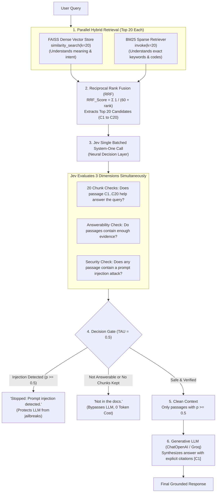

# Hybrid RAG with Reciprocal Rank Fusion & Jev Decision Layer

[](https://www.python.org/downloads/)
[](https://github.com/facebookresearch/faiss)
[](https://github.com/dorianbrown/rank_bm25)
[](https://huggingface.co/sentence-transformers/all-MiniLM-L6-v2)
[](https://typesafe.ai)
[](LICENSE)

An enterprise-grade, high-precision **Hybrid Retrieval-Augmented Generation (RAG)** pipeline combining **Dense Semantic Search (FAISS)** and **Sparse Keyword Search (BM25)** via **Reciprocal Rank Fusion (RRF)**, backed by a **Dual-Process Jev Decision Layer** for neural relevance verification, answerability gating, and prompt injection defense.

---

## Architecture & Data Flow



---

## Detailed Step-by-Step Flow

### 1. Document Ingestion & Chunking
- Ingests documents from `sample_docs/` (`.md`, `.pdf`, `.docx`, `.txt`) and custom paths configured in `.env`.
- Splits text into 500-character chunks with a 50-character overlap using LangChain's `RecursiveCharacterTextSplitter`.

### 2. Dual Search (Hybrid Retrieval)
- **FAISS (Dense):** Embeds text with `sentence-transformers/all-MiniLM-L6-v2` into high-dimensional geometric space to capture semantic meaning and intent. Retrieves the Top 20 dense matches.
- **BM25 (Sparse):** Tokenizes documents and computes term frequency / inverse document frequency (TF-IDF). Retrieves the Top 20 keyword matches (critical for product codes, exact terms, and names).

### 3. Reciprocal Rank Fusion (RRF)
Raw scores from vector cosine similarity and BM25 cannot be directly added because their scales differ. RRF harmonizes them using their rank positions:

$$\text{RRF Score}(d) = \sum_{m \in \{\text{Dense}, \text{BM25}\}} \frac{1}{60 + \text{Rank}_m(d)}$$

The candidates are sorted by their combined RRF score to select the **Top 20 unified candidate passages** (`C1` through `C20`).

### 4. Jev Decision Layer (TypeSafe AI)
Instead of overwhelming the LLM with 20 passages, Jev runs a high-speed batched evaluation:
1. **Passage Relevance:** Grades each passage `C1`..`C20` with a calibrated probability (`Noul`) answering: *"Does passage `passages.C{i}` help answer the question?"*
2. **Answerability:** Checks if the combined context actually contains enough information to answer the question.
3. **Prompt Injection Defense:** Scans all retrieved passages for adversarial text aimed at manipulating the AI (e.g. *"ignore previous instructions"*).

### 5. Gating & Generation
- If **Injection $\ge 0.5$**: The system halts immediately.
- If **Answerable $< 0.5$** or no chunks meet the threshold: The system returns *"Not in the docs."* without invoking the LLM.
- If verified: Formats the passing chunks into a concise context block and prompts the LLM to generate an answer with strict citations (`[C1]`, `[C2]`).

---

## Project Structure

```text
├── rag.py               # Complete Hybrid RAG pipeline (FAISS + BM25 + RRF + Jev + LLM)
├── requirements.txt     # Python dependencies
├── .env.example         # Template for environment configuration
├── .gitignore           # Git ignore rules (protects credentials & personal documents)
├── sample_docs/         # Directory for documents (.md, .pdf, .docx, .txt)
│   └── company_policies.md
└── README.md            # Project documentation
```

---

## Getting Started

### 1. Prerequisites
- Python 3.10+
- An OpenAI-compatible API key (Groq, OpenAI, or AgentRouter)
- A [TypeSafe AI](https://typesafe.ai) API key for the Jev decision layer

### 2. Installation

```bash
# Clone the repository
git clone https://github.com/sibi45/JEV-RAG.git
cd JEV-RAG

# Create virtual environment
python -m venv venv

# Activate virtual environment
# Windows (PowerShell):
.\venv\Scripts\Activate.ps1
# macOS / Linux:
source venv/bin/activate

# Install dependencies
pip install -r requirements.txt
```

### 3. Environment Configuration

Copy `.env.example` to `.env`:

```bash
cp .env.example .env
```

Set your credentials in `.env`:

```env
# LLM Endpoint
AGENT_ROUTER_API_KEY="your-llm-api-key"
BASE_URL="https://api.groq.com/openai/v1"
MODEL="openai/gpt-oss-120b"

# TypeSafe AI Jev Key
TYPESAFE_API_KEY="your-typesafe-api-key"

# Optional path to a specific document
DOCUMENT="sample_docs/company_policies.md"
```

---

## Usage

Run the interactive CLI:

```bash
python rag.py
```

### Example Output

```text
Loading documents...
Created 14 chunks.
Building FAISS Dense Vector Index & BM25 Sparse Index...
Loading weights: 100%|██████████| 103/103

Hybrid RAG + Jev System Ready!

Ask a question (or 'quit'): What is the remote work policy?

--- JEV EVALUATION SCORES ---
  C1: Score 0.94
  C2: Score 0.88
  Overall Answerable: 0.96
  Injection Risk:     0.02

--- ANSWER ---
Full-time employees are eligible for up to two remote workdays per week with prior manager approval [C1]. Core collaboration hours are 10:00 AM to 4:00 PM local time [C1].

Ask a question (or 'quit'): quit
```

---

## Why Hybrid Search + Jev?

| Feature | Standard RAG | Hybrid Search + Jev (This Project) |
| :--- | :--- | :--- |
| **Keyword Accuracy** | ❌ Misses exact codes or misaligned synonyms | ✅ **BM25** captures exact terms; **FAISS** captures concepts |
| **Ranking Fairness** | ❌ Single ranking metric prone to bias | ✅ **RRF** blends dense & sparse ranks mathematically |
| **Noise & Hallucination**| ❌ Sends all chunks blindly to the LLM | ✅ **Jev** filters out weak chunks below `TAU = 0.5` |
| **Security** | ❌ Vulnerable to indirect prompt injections | ✅ **Jev** scans for prompt injection attacks before synthesis |
| **Cost Efficiency** | ❌ Always triggers expensive LLM calls | ✅ Aborts early if context is unanswerable |

---

## License

This project is licensed under the [MIT License](LICENSE).
